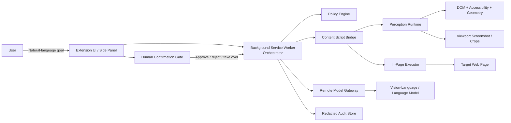
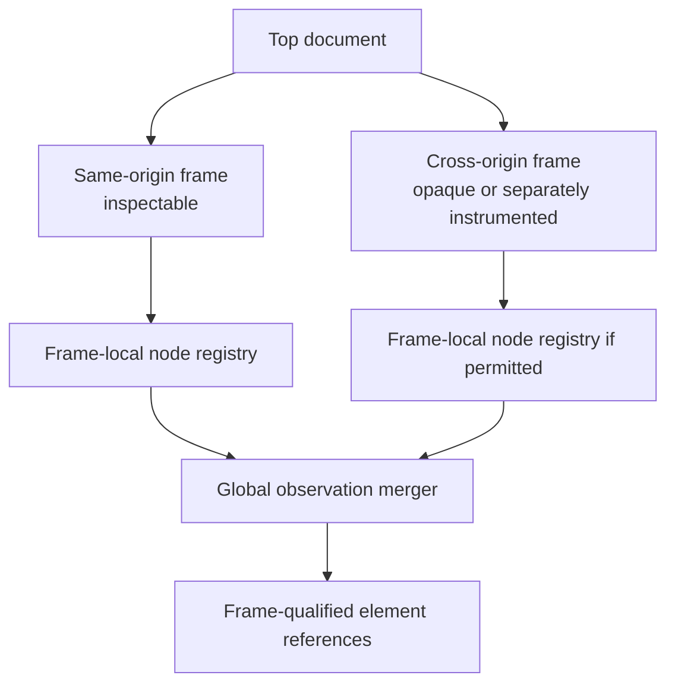
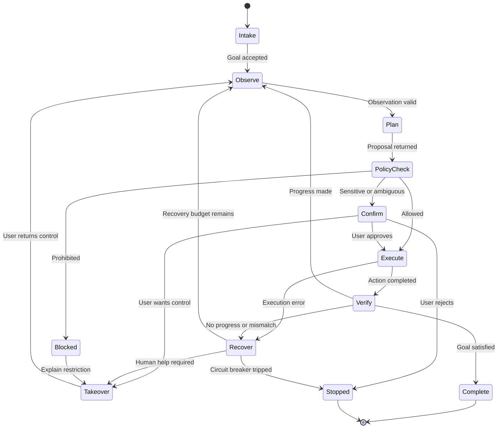

# FlexiData Browser Agent
## Production-Grade Architecture Specification

**Document status:** Architecture baseline

**Audience:** Principal engineers, browser-extension engineers, applied AI engineers, security engineers, and product owners

**Scope:** Manifest V3 Chrome Extension with autonomous, multi-step browser workflow execution

**Author:** Manus AI

---

## 1. Executive Summary

FlexiData Browser Agent should be designed as a **partially observable, event-driven control system** rather than as a script that issues clicks. Each agent turn must combine a compact structural representation of the page with an optional visual representation, select an action from a constrained and typed action space, execute that action through a browser-native adapter, and verify the resulting state before continuing.

The recommended design separates five concerns:

1. **Perception** builds a stable, versioned world model from the DOM, accessibility tree, viewport geometry, screenshots, frame metadata, and page lifecycle signals.
2. **Execution** exposes safe, typed primitives that prefer semantic element references over raw coordinates and revalidates every target immediately before acting.
3. **The agent core** runs a bounded state machine with explicit planning, acting, verification, recovery, and human-confirmation states.
4. **Context management** maintains a compact task ledger and summarized trajectory instead of sending unbounded screenshots and DOM snapshots to the model.
5. **Security and governance** enforce least privilege, origin isolation, secret minimization, confirmation gates, auditability, and fail-closed behavior.

The extension should not grant the language model unrestricted access to browser internals. The model receives a normalized observation and proposes a typed action. A policy engine validates the action, an executor performs it, and a verifier determines whether the intended transition occurred. This separation is the principal control against prompt injection, accidental destructive actions, coordinate drift, and infinite loops.

> **Design principle:** The model may propose; deterministic browser-side components decide whether and how the proposal is executed.

The architecture assumes that some workflows will be impossible to complete autonomously. CAPTCHA challenges, cross-origin restrictions, inaccessible browser UI, authentication prompts, and ambiguous high-impact actions must transition to a human-in-the-loop state rather than being bypassed.

---

## 2. Goals, Non-Goals, and Quality Attributes

### 2.1 Goals

The system must support natural-language workflows that span multiple pages and applications. It must tolerate modern web behavior, including single-page applications, asynchronous rendering, lazy loading, nested frames, and Shadow DOM. It must provide grounded actions that can be traced to observed page state. It must recover from ordinary transient failures and stop safely when confidence is low.

The extension must support both:

- **Semantic execution**, such as selecting a button or filling a field by a stable element reference.
- **Visual execution**, such as interacting with canvas-based controls or visually rendered elements that lack usable DOM semantics.

The system must preserve a complete audit trail for every observation, proposed action, policy decision, execution result, and verification result, subject to configured redaction and retention policies.

### 2.2 Non-goals

The first architecture should not attempt to control arbitrary browser chrome UI, operating-system dialogs, native file pickers, or websites that deliberately prevent automation. Those capabilities require separate privileged integrations and materially different security boundaries.

The system should not attempt to defeat CAPTCHA, anti-bot systems, access controls, paywalls, or authentication challenges. It may detect such states and ask the user to take over.

The agent should not silently make financial transactions, delete records, send external communications, change account security, or submit official records. These actions require a confirmation gate, even when the user’s original instruction appears to authorize them.

### 2.3 Quality attributes

| Attribute | Architectural requirement |
|---|---|
| Safety | Fail closed on policy uncertainty, stale targets, origin changes, and verification ambiguity. |
| Grounding | Every action references an observation revision and target evidence. |
| Reliability | Use bounded retries, state-transition verification, and recovery plans. |
| Responsiveness | Prefer incremental DOM deltas and cropped screenshots over full-page recapture. |
| Privacy | Redact sensitive content before remote model calls and minimize retained data. |
| Explainability | Expose why an action was selected, allowed, blocked, retried, or escalated. |
| Extensibility | Keep perception, model providers, policies, and executors behind versioned interfaces. |
| Portability | Use standard DOM and accessibility concepts, while isolating Chrome-specific APIs in adapters. |

---

## 3. System Context and Trust Boundaries

FlexiData Browser Agent consists of a browser-resident control plane and an optional remote intelligence plane. The remote plane should receive only the minimum observation needed for the current decision.

### 3.1 Trust zones

**Zone A: User and extension UI.** The side panel displays the current goal, plan summary, pending confirmation, progress, and takeover controls. It must not expose raw secrets or unredacted page content by default.

**Zone B: Background service worker.** This is the orchestration authority. It owns the session state, policy decisions, model calls, rate limits, audit events, and communication with content scripts. It must assume that page content is hostile input.

**Zone C: Content script and perception runtime.** This code runs in the context of a target tab and can inspect or manipulate page content according to host permissions. It must treat every DOM string, attribute, accessible name, and page message as untrusted data.

**Zone D: Target origin.** The visited site is outside FlexiData’s trust boundary. Page scripts can mutate the DOM, attempt prompt injection, intercept or spoof messages, and create deceptive visual content.

**Zone E: Remote model gateway.** This service processes task observations and returns proposals. It must be isolated behind an authenticated gateway that applies redaction, size limits, model routing, provider policy, and response validation.

### 3.2 Message authority model

The background service worker is the only component allowed to authorize an action. A content script may report observations and execute a previously authorized action, but it must reject messages without a valid session identifier, tab identifier, observation revision, action nonce, and expiration time.

Messages should use a discriminated envelope with a message type, schema version, session identifier, sender identity, timestamp, and correlation identifier. Every request must receive a response or an explicit timeout result. Broadcast-style messages should be avoided for action authorization.

---

## 4. Component Breakdown

### 4.1 Extension UI

The UI provides task intake, current-state visibility, confirmation prompts, pause and stop controls, and human takeover. It must make the agent’s next consequential action visible before execution. For sensitive actions, the UI must show the target origin, action description, affected data, and the exact values or recipients when feasible.

The UI should never be the source of truth for execution state. It subscribes to state snapshots emitted by the background service worker and can request safe transitions such as pause, resume, stop, or takeover.

### 4.2 Background orchestrator

The orchestrator owns the session state machine. It coordinates observation requests, model calls, policy evaluation, action dispatch, verification, recovery, token budgeting, and audit logging. Since Manifest V3 service workers can be suspended, state must be persisted incrementally in extension storage or an external session store. In-memory state is a cache, not durable state.

### 4.3 Perception runtime

The perception runtime runs in the content script and produces a normalized page observation. It should maintain a per-document cache and emit a full snapshot on first observation followed by deltas when the page changes. It should use `MutationObserver`, lifecycle signals, bounded polling, and explicit action-triggered refreshes rather than continuous expensive serialization.

### 4.4 Browser-native adapters

Chrome-specific capabilities should be isolated behind adapters for tab navigation, screenshots, downloads, storage, scripting, permissions, and messaging. This prevents Chrome API details from leaking into the model or policy layers and makes future browser support possible.

### 4.5 Policy engine

The policy engine is deterministic. It classifies actions by risk, checks origin and permission constraints, validates target freshness, applies user and organization rules, and determines whether execution is allowed, requires confirmation, must be blocked, or should be escalated.

### 4.6 Model gateway

The gateway converts an observation into a model request and validates the response against a strict action schema. It must support model timeouts, provider fallback, token budgets, structured output, content redaction, and a no-tool execution mode in which the model cannot directly invoke browser APIs.

### 4.7 Audit and telemetry subsystem

Audit events should be append-only from the extension’s perspective. Each event references the session, tab, origin, observation revision, action identifier, policy decision, and verification result. Sensitive values should be hashed, masked, or omitted according to field classification.

---

## 5. Pillar One: Perception Layer

### 5.1 Perception outputs

The perception layer should produce four related artifacts:

1. **Structural snapshot:** interactive and relevant non-interactive nodes, semantic roles, labels, state, text, frame path, and stable references.
2. **Geometry map:** viewport-relative rectangles, visibility, occlusion estimates, scroll container, and coordinate-system metadata.
3. **Visual evidence:** viewport screenshot, selected crops, or a lower-resolution full-page image when visual reasoning is needed.
4. **Lifecycle evidence:** URL, title, load state, network activity summary, DOM revision, focused element, and recent mutations.

The model should normally receive the structural snapshot first. A screenshot should be included when visual layout, canvas content, chart interpretation, spatial relationships, or unresolved structural ambiguity makes it useful.

### 5.2 DOM extraction strategy

The extractor should identify native interactive elements and elements with interaction-like behavior. It should include buttons, links, inputs, textareas, selects, comboboxes, checkboxes, radios, sliders, tabs, menu items, dialogs, draggable items, content-editable regions, and elements with event-handler or role signals. It should also include nearby headings, labels, error messages, table headers, and selected text when they establish meaning.

The extractor must avoid serializing the entire DOM by default. It should use a relevance filter based on viewport visibility, semantic interactivity, focus state, proximity to the current target, text relevance, and recent mutation status. It should represent repeated lists and large tables using bounded windows with continuation metadata rather than unbounded content.

Text must be normalized while preserving meaning. Hidden text, off-screen text, CSS-generated content, and ARIA labels should be distinguished rather than merged into one ambiguous string. Password values and other sensitive input values must never be returned to the model.

### 5.3 Dynamic pages and SPAs

For single-page applications, URL changes are insufficient to identify a new state. The runtime should track a document identity, DOM revision, visible landmark hash, focused element, and a compact mutation summary. Navigation events, history API changes, route-like title changes, dialog appearance, and major landmark changes should trigger a new observation revision.

The runtime should debounce mutation bursts. A stable-state detector can declare the page quiescent when no high-impact mutations occur for a short adaptive interval and no tracked network activity remains, subject to a maximum wait. The agent must not wait indefinitely for “network idle,” because analytics, streaming, polling, and long-lived connections can prevent it.

Lazy-loaded content requires an explicit visibility and pagination strategy. Before concluding that an element or record does not exist, the agent should be allowed a bounded sequence of scroll, expand, pagination, or search actions. The observation should record which regions have been explored so that the model does not repeatedly revisit them.

### 5.4 Iframes and cross-origin frames

Every element reference must include a frame path. Same-origin frames may be inspected through a frame-local perception runtime. Cross-origin frames cannot be inspected by the parent content script and must be handled by a separately injected, permission-eligible runtime in the child frame or treated as opaque.

The observation must explicitly state frame accessibility. The model must not infer that an opaque frame is empty. Actions targeting a cross-origin frame must be dispatched through the appropriate frame context and revalidated there.

### 5.5 Shadow DOM

Open Shadow DOM roots should be traversed with an explicit boundary marker so that the model understands component ownership. Closed Shadow DOM roots cannot be reliably inspected through ordinary page JavaScript and should be represented as opaque regions unless a supported browser-level accessibility or automation interface exposes them.

Element references should include a shadow path such as host reference plus a sequence of open-root descendants. The executor must resolve the path at action time and fail with a typed `shadow_path_stale` error if a component re-render invalidates it.

### 5.6 Element identity and tags

A model-facing element identifier must be stable for the lifetime of an observation, not necessarily for the lifetime of the page. The recommended identifier contains:

- Observation revision.
- Frame path.
- Local registry index.
- A short integrity token derived from the node’s structural signature.

For example, the conceptual form is `obs-42/frame-0.shadow-2/node-17.sig-ab12`. This is a reference, not a DOM selector and not a secret. It prevents a stale action from silently applying to a newly created element that happens to reuse an index.

The structural signature should combine tag name, role, normalized accessible name, relevant attributes, ancestor landmarks, and a geometry bucket. It must not contain full sensitive values. When the visual renderer draws tags such as `[17]`, the tag must be placed next to the rectangle of the corresponding element and included in the screenshot-to-observation mapping.

### 5.7 Geometry and visual grounding

All rectangles should be recorded in CSS viewport coordinates, with the viewport width, viewport height, device pixel ratio, scroll offsets, visual viewport offsets, zoom factor if available, and screenshot pixel dimensions. Conversion to screenshot pixels must be deterministic and reversible.

The perception runtime should calculate:

- Bounding rectangle.
- Whether any portion is inside the visual viewport.
- Effective clickable point candidates.
- Occlusion estimate from `elementFromPoint` checks.
- Fixed, sticky, or scroll-container context.
- Whether the target is disabled, inert, covered, or outside the active frame.

Coordinate clicks are a fallback. Before execution, the executor should refresh geometry, confirm that the target remains visible, recompute a safe point, and compare the current target signature with the referenced signature. If the page has shifted, it should re-ground the target rather than blindly clicking old coordinates.

### 5.8 Screenshot policy

Screenshots should be captured only when they add information. A useful policy is:

- Capture a viewport screenshot after navigation, major layout mutation, failed semantic grounding, or a visual task.
- Capture a crop around candidate targets when the full viewport is unnecessary.
- Downscale images to a model-appropriate resolution while retaining enough detail to read controls.
- Keep the original screenshot locally for audit only when policy permits.

Sensitive regions should be masked before remote transmission. Masking should cover password fields, payment credentials, government identifiers, authentication codes, and configured domain-specific patterns. The redaction event must be recorded so the model understands that information is intentionally unavailable.

---

## 6. Pillar Two: Action Space and Execution Primitives

### 6.1 Action design

The action space should be typed, finite, and composable. Every action includes a target reference or explicit scope, a precondition summary, a timeout, and an expected observation change. The model should not be able to emit arbitrary JavaScript.

| Primitive | Purpose | Required safeguards |
|---|---|---|
| `navigate` | Open a URL or return to a known route. | Scheme and origin policy, download/navigation policy, redirect verification. |
| `click` | Activate a semantic target or fallback coordinate. | Fresh target resolution, visibility, occlusion, enabled-state check. |
| `type` | Replace or append text in a field. | Field classification, secret handling, value redaction, event verification. |
| `select_option` | Choose an option in a native or custom select. | Option identity and resulting value verification. |
| `toggle` | Set a checkbox, switch, or radio state. | Desired-state verification and confirmation for consequential settings. |
| `scroll` | Scroll a viewport or identified container. | Bounded amount, direction, container identity, post-scroll observation. |
| `hover` | Reveal menus or tooltips. | Short timeout, no assumption that hover persists. |
| `focus` | Focus a target without changing data. | Fresh target and focus verification. |
| `press_key` | Send a named key or bounded key combination. | Allowlist, modifier restrictions, target scope, no arbitrary key injection. |
| `wait` | Wait for a condition or bounded time. | Explicit condition, maximum duration, cancellation. |
| `wait_for_navigation` | Wait for URL/document/landmark change. | Timeout and navigation-failure classification. |
| `wait_for_stability` | Wait for bounded DOM/layout quiescence. | Adaptive interval and hard maximum. |
| `find` | Search within the current page or application UI. | Scope and query length limits; no hidden-page assumption. |
| `download` | Request a page-provided download. | Origin, file-type, path, and malware policy; user visibility. |
| `extract` | Read specific, visible page data. | Selector by grounded reference, sensitivity policy, size bound. |
| `upload` | Select a user-approved local file. | Explicit user consent, file allowlist, no arbitrary filesystem access. |
| `back` / `forward` / `reload` | Browser navigation controls. | Session history awareness and unsaved-data warning detection. |
| `request_confirmation` | Pause for a human decision. | Required for risk-classified actions. |
| `take_over` | Transfer control to the user. | Freeze automation and preserve state. |
| `stop` | End the session safely. | Cancel in-flight actions and persist final status. |

### 6.2 Semantic-first execution

The executor should use this order of preference:

1. Resolve and act on a fresh element reference.
2. Re-ground by structural signature if the reference is stale but the target remains unambiguous.
3. Use a visual coordinate only when semantic resolution is unavailable and the action policy allows it.
4. Escalate when more than one plausible target remains or the target has materially changed.

Coordinates should never be treated as durable identifiers. Responsive resizing, zoom, sticky headers, virtualized lists, and asynchronous layout changes can invalidate them between observation and execution.

### 6.3 Reliable text input

Text entry should be implemented as a browser-side operation that focuses the target, selects or clears according to an explicit mode, and sets the value through the control’s native value behavior. It must dispatch the input and change events expected by common frameworks and then verify the resulting accessible value or UI state.

For React, Vue, Angular, and custom controls, the executor should treat event dispatch as necessary but not sufficient. It must observe the framework-visible result, such as a changed label, enabled submit button, validation state, or persisted field value. It should support content-editable elements separately from native inputs and should not use one generic setter for all controls.

Human-like timing should be used only as a reliability or anti-burst measure, not as an evasion mechanism. Randomized delays must have bounded ranges, be disabled for sensitive fields where predictability is preferable, and never be marketed as a way to defeat bot detection.

### 6.4 Action preconditions and postconditions

Each action should contain a precondition such as “target is visible, enabled, and has signature X” and a postcondition such as “URL changed,” “field value changed,” “dialog appeared,” or “target state became checked.” If a postcondition cannot be stated, the action should be classified as weakly verifiable and receive a lower retry budget.

---

## 7. Pillar Three: Agent Core Loop and State Machine

### 7.1 Control loop

The core loop is a closed-loop controller:

### 7.2 Session states

**Intake** validates the goal, identifies requested outputs, and asks clarifying questions only when ambiguity materially affects behavior. It also establishes an initial risk profile.

**Observe** obtains a fresh observation and assigns a revision. The system should not reuse an observation after navigation, significant mutation, viewport change, or an action that may have changed the target.

**Plan** asks the model for one next action or a short bounded plan. A single next action is safer for dynamic pages. Multi-action plans may be used for deterministic local sequences only when each step has a clear precondition and can be independently canceled.

**PolicyCheck** validates the action against origin, permissions, risk, target freshness, allowed primitive types, and user policy. It also detects prompt-injection indicators in page content and prevents page text from changing the system’s instructions.

**Execute** dispatches the authorized action with a nonce and timeout. The executor reports start, progress, completion, and typed failure.

**Verify** compares the expected postcondition with a fresh observation. Verification should use multiple signals when possible: URL or title change, DOM landmark change, field state, visible success or error message, download event, or application-specific result.

**Recover** chooses from bounded recovery strategies such as refresh observation, scroll, dismiss a non-destructive dialog, return to a known route, retry with a new target, or ask the user. Recovery must not escalate privileges or weaken policy.

### 7.3 Success and failure detection

Goal completion should be represented by explicit predicates. Examples include a target record appearing in a result set, a download being finalized with an expected file type, a dashboard value matching a requested condition, or a form reaching a submitted confirmation state.

Failure signals include:

- Visible validation errors or server error banners.
- Authentication expiry or permission-denied pages.
- CAPTCHA or bot-verification challenges.
- Navigation timeout, redirect loop, or unexpected origin.
- Stale target, detached node, or occluded element.
- No material observation change after an action.
- Repeated identical screenshots or DOM hashes.
- A destructive action reaching a confirmation screen without user approval.

The verifier should distinguish **known failure**, **unknown outcome**, and **success**. An unknown outcome must not be treated as success, particularly after submissions, downloads, or external side effects.

### 7.4 Circuit breakers and loop detection

The session should have global limits for elapsed time, model turns, actions, navigation count, downloads, and recovery attempts. It should also maintain local limits per target and per action type.

Loop detection should combine:

- Repeated action signature over a sliding window.
- Repeated observation fingerprint with no progress marker.
- Repeated error class on the same target.
- Oscillation between two pages or two UI states.
- Repeated scrolling without new content discovery.

When a threshold is reached, the agent should stop taking autonomous actions and present a concise explanation. A circuit breaker must be reset only by a materially new observation, an explicit user instruction, or a fresh session policy decision.

---

## 8. Pillar Four: Context and Memory Management

### 8.1 Context layers

A robust session uses four memory layers:

1. **Goal ledger:** immutable user intent, constraints, desired outputs, and risk boundaries.
2. **Current world model:** the latest observation, target registry, frame map, page lifecycle state, and known application landmarks.
3. **Recent trajectory:** the last several actions with preconditions, results, errors, and verification outcomes.
4. **Compressed history:** summaries of completed subgoals, pages visited, discovered identifiers, failed approaches, and recovery decisions.

The model should receive the goal ledger on every turn, the current world model in full or a relevant slice, and only the recent trajectory plus compressed history needed to choose the next action.

### 8.2 Observation compression

Structural observations should be canonicalized before hashing and comparison. Repeated text, invisible nodes, volatile attributes, timestamps, tracking parameters, and animation-only changes should be normalized or excluded. Large tables and lists should be summarized with row windows and stable keys.

Screenshots should be selected by relevance. A screenshot descriptor should state the viewport dimensions, crop coordinates, redactions, and the observation revision. If the image is unchanged, the next model request can reference the previous visual evidence instead of retransmitting it, subject to provider capabilities and retention rules.

### 8.3 Summarization boundaries

Summaries must preserve facts that affect future action:

- The user’s exact goal and constraints.
- Current origin and authentication state.
- Completed subgoals and their evidence.
- Values entered, excluding secrets in plaintext.
- Known record identifiers and output locations.
- Failed targets and why they failed.
- Pending confirmation requirements.
- Circuit-breaker counters and remaining budgets.

Summaries must not silently convert uncertainty into fact. They should label information as observed, inferred, user-provided, or pending verification.

### 8.4 Token budgeting

Token allocation should be adaptive. Reserve a fixed budget for the goal and policy instructions, a larger budget for the current observation, and a bounded budget for trajectory context. If the observation is too large, reduce it by relevance ranking rather than truncating arbitrarily at the end.

The model gateway should reject oversized requests before transmission and emit a structured `context_reduced` event. The system should be able to continue from a compact checkpoint after service-worker suspension or model failure.

---

## 9. Pillar Five: Security, Guardrails, and Permissions

### 9.1 Manifest V3 principles

The extension should request the narrowest host permissions required for supported workflows. Optional host permissions are preferable when the product can request access at task time. Content Security Policy must prohibit unsafe dynamic code execution, and the extension must not turn page-provided strings into executable extension code.

The service worker should be treated as a privileged broker. Content scripts should have no authority to call remote model providers directly, change extension settings, or authorize actions. Use explicit message validation and sender checks. Do not trust a sender merely because it is a content script from a tab; verify the tab, frame, extension origin, session, and expected message direction.

### 9.2 Prompt-injection resistance

Page content is data, not instruction. The observation format should separate system policy, user goal, and page-derived text using distinct fields. The model prompt should state that page content may contain malicious instructions and must never override system, user, or policy constraints.

The perception layer should flag common injection indicators, such as text addressing the agent, requests to reveal hidden instructions, requests to upload secrets, or instructions to bypass security checks. Detection is advisory; policy enforcement must remain deterministic.

The agent must never disclose hidden prompts, credentials, cookies, extension storage, or unrelated tabs based solely on page content.

### 9.3 Sensitive actions and confirmation gates

Actions should be risk-classified before execution:

| Risk class | Examples | Default behavior |
|---|---|---|
| R0: Observation | Read visible text, inspect layout. | Allow if within permission scope. |
| R1: Reversible interaction | Scroll, hover, focus, expand a menu. | Allow with normal verification. |
| R2: Local mutation | Fill a draft field, change a filter, add a temporary item. | Allow or confirm according to user policy. |
| R3: External side effect | Send email, publish content, create an appointment, upload a file. | Require confirmation immediately before execution. |
| R4: High impact or destructive | Financial transaction, deletion, account-security change, legal or official submission. | Require explicit confirmation with exact payload; otherwise block. |

The confirmation gate must be bound to the exact action, target origin, payload summary, and observation revision. Approval expires if the page changes materially, the action is modified, or a timeout elapses. A generic “the user asked for this earlier” is not sufficient for R3 or R4 actions.

### 9.4 Secrets and privacy

Credentials should be handled by browser-managed authentication or an approved secret broker, not copied into model context. Password values, one-time codes, payment details, and private messages should be redacted from screenshots, DOM snapshots, logs, and telemetry.

Data minimization should operate at collection, transmission, display, and retention stages. Tenant policies should define allowed origins, prohibited data classes, retention period, model-provider restrictions, and whether screenshots may leave the device.

### 9.5 Downloads and uploads

Downloads should be treated as external side effects. The policy engine should validate origin, expected file type, filename constraints, and whether user confirmation is required. The extension should not silently execute downloaded files.

Uploads require a user-approved file selection or a tightly scoped file broker. The agent must not search the local filesystem broadly or exfiltrate files based on page instructions.

---

## 10. Canonical Data Schemas

The following schemas are conceptual contracts. They define the fields and invariants that implementations should preserve; they are not implementation code.

### 10.1 Session record

| Field | Meaning |
|---|---|
| `session_id` | Globally unique session identifier. |
| `goal` | Immutable normalized user objective. |
| `constraints` | Allowed origins, time limits, output requirements, and risk policy. |
| `state` | Current state-machine state. |
| `active_tab` | Tab and frame context currently controlled. |
| `observation_revision` | Latest accepted observation revision. |
| `budgets` | Remaining action, time, navigation, model, and recovery budgets. |
| `confirmation` | Pending confirmation payload, if any. |
| `memory_checkpoint` | Latest durable goal and trajectory summary. |
| `created_at` / `updated_at` | Lifecycle timestamps. |

### 10.2 Element reference

| Field | Meaning |
|---|---|
| `ref_id` | Observation-scoped model-facing identifier. |
| `observation_revision` | Revision that created the reference. |
| `frame_path` | Top document, child-frame, and shadow-root path. |
| `role` | Normalized semantic role. |
| `accessible_name` | Redacted accessible name. |
| `state` | Enabled, checked, expanded, selected, required, invalid, and focused flags. |
| `geometry` | CSS viewport rectangle and coordinate metadata. |
| `visibility` | Visible, partially visible, occluded, offscreen, or opaque. |
| `signature` | Short integrity token for stale-target detection. |
| `sensitivity` | None, personal, secret, financial, or tenant-defined class. |

### 10.3 Action proposal

| Field | Meaning |
|---|---|
| `action_id` | Unique proposal identifier. |
| `primitive` | One action from the allowlisted action space. |
| `target_ref` | Element reference, when required. |
| `arguments` | Typed, bounded primitive arguments. |
| `reason` | Concise grounding rationale. |
| `preconditions` | Conditions that must hold before execution. |
| `expected_effect` | Observable postcondition. |
| `risk_class` | Policy-assigned risk classification. |
| `confidence` | Model confidence, never a policy decision. |
| `observation_revision` | Observation on which the proposal was based. |
| `expires_at` | Short validity deadline. |

### 10.4 Execution result

| Field | Meaning |
|---|---|
| `action_id` | Proposal being executed. |
| `status` | Started, completed, blocked, failed, timed out, or canceled. |
| `error_code` | Typed failure code, if any. |
| `actual_target` | Resolved target signature and frame. |
| `side_effects` | Navigation, download, mutation, or external-effect indicators. |
| `post_observation_revision` | Revision created after execution. |
| `verification` | Success, failure, unknown, and evidence summary. |
| `duration_ms` | Execution duration. |

---

## 11. Failure Modes and Mitigations

| Failure mode | Detection | Mitigation |
|---|---|---|
| Stale DOM reference | Signature mismatch or detached node | Refresh observation and re-ground; do not reuse coordinates. |
| Responsive layout shift | Geometry revision or viewport change | Recompute target rectangle and safe point. |
| SPA route change without navigation | Landmark, title, history, or mutation change | Create a new observation revision. |
| Infinite loading | Stability timeout and active-request summary | Continue with partial observation, retry boundedly, or escalate. |
| Virtualized list | Target absent until scroll | Explore boundedly and record explored ranges. |
| Cross-origin iframe | Frame inaccessible | Use frame-local instrumentation if permitted or escalate. |
| Closed Shadow DOM | Opaque component boundary | Use accessibility/visual fallback or ask user. |
| Element occluded | `elementFromPoint` mismatch or overlay detection | Dismiss only safe overlays, scroll, or escalate. |
| Framework ignores input | Postcondition not met | Use framework-compatible native input path and verify state. |
| CAPTCHA / bot challenge | Known visual/semantic indicators | Stop automation and request human takeover. |
| Authentication expiry | Login page or unauthorized response | Pause and request user takeover; never request credentials in model context. |
| Prompt injection | Suspicious page text or attempted instruction override | Treat as data, preserve policy, and block unsafe requested action. |
| Navigation failure | Timeout, redirect loop, unexpected origin | Stop or return to last known safe state. |
| Duplicate submission | Repeated click or uncertain result | Verify before retry; require confirmation for side effects. |
| Download ambiguity | Missing event or unexpected file | Mark outcome unknown and ask the user rather than claiming success. |
| Service-worker suspension | Missing in-memory state | Restore from durable checkpoint and invalidate old action nonces. |
| Model outage | Timeout or invalid structured response | Retry with bounded backoff, use approved fallback, or escalate. |

---

## 12. Observability, Testing, and Release Controls

### 12.1 Auditability

Every autonomous turn should generate an audit chain: observation received, sensitive data redacted, model request created, proposal returned, policy decision made, action executed, postcondition verified, and session state transitioned. The chain should be correlatable without retaining raw secrets.

### 12.2 Test strategy

Testing should be layered. Unit tests should cover canonicalization, geometry conversion, target signatures, policy classification, schema validation, and circuit breakers. Integration tests should cover messaging, frame handling, service-worker suspension, downloads, and permission boundaries. Browser fixtures should include React, Vue, Angular, content-editable controls, virtualized lists, Shadow DOM, nested frames, overlays, infinite scroll, and deliberate prompt injection.

End-to-end tests should use deterministic test sites with explicit success and failure markers. They should verify that the agent stops at confirmation gates and does not perform prohibited actions even when page text instructs it to do so.

### 12.3 Evaluation metrics

Track task completion rate, verified completion rate, unsafe-action rate, false confirmation rate, stale-target recovery rate, average actions per successful task, average model turns, token volume, human takeover rate, and time to recovery. Safety metrics must be treated as release blockers rather than averaged away by successful benign tasks.

### 12.4 Rollout controls

Use feature flags for new primitives, origin allowlists, model providers, and risk policies. Start with read-only and reversible workflows. Enable external side effects only after policy simulation, fixture testing, human review, and audit validation. Maintain a kill switch that prevents new action dispatch while preserving session inspection and safe stop behavior.

---

## 13. Recommended Execution Strategy

A staged implementation is safer than attempting full autonomy immediately.

**Stage 1: Grounded observation.** Implement DOM, accessibility, geometry, frame, Shadow DOM, screenshot, redaction, and observation revision contracts. Do not allow autonomous mutations.

**Stage 2: Reversible primitives.** Enable focus, scroll, hover, find, expand, and bounded navigation with deterministic postcondition checks.

**Stage 3: Form interaction.** Enable semantic typing, selection, toggles, and validation-state verification on a curated origin allowlist.

**Stage 4: Recovery and memory.** Add durable checkpoints, summarized trajectory, circuit breakers, SPA handling, lazy-load exploration, and human takeover.

**Stage 5: Controlled side effects.** Add downloads, uploads, external communications, and submissions behind explicit risk policies and confirmation gates.

**Stage 6: Scale and governance.** Add tenant policy management, model routing, provider controls, audit retention, evaluation suites, and operational dashboards.

The system should remain useful at each stage. A read-only agent that produces reliable grounded plans is a valuable foundation and a safer diagnostic tool than an unreliable fully autonomous executor.

---

## 14. Architectural Decisions and Open Questions

### Decisions

- Use a background service worker as the authorization and orchestration authority.
- Use content-script perception with frame-qualified, observation-scoped element references.
- Prefer semantic target resolution over coordinates.
- Treat screenshots as supplemental evidence rather than the sole source of truth.
- Require deterministic verification after every action.
- Use explicit risk classes and just-in-time confirmation for side effects.
- Persist checkpoints because service-worker lifetime is not guaranteed.
- Keep page content isolated from system and user instructions.

### Open questions

The product team must still decide which origins are supported initially, which model providers may receive redacted observations, whether screenshots may leave the device, how organization-specific risk policies are administered, and which file workflows are in scope. These choices affect permission design, privacy controls, and the confirmation UX and should be resolved before implementation of side-effecting primitives.

---

## 15. Conclusion

FlexiData Browser Agent should be implemented as a **policy-governed closed-loop browser controller**. The central engineering challenge is not generating clicks; it is maintaining a trustworthy relationship between the model’s proposed intent, the page state that was actually observed, the target that was resolved, and the effect that was verified.

A production system must therefore make state explicit, make actions typed, make targets temporary and verifiable, make page content untrusted, make side effects confirmable, and make failure a first-class outcome. This architecture provides those controls while leaving room for stronger models, richer visual grounding, additional browsers, and domain-specific workflow adapters.

---

## References

[1]: https://developer.chrome.com/docs/extensions/develop/concepts/manifest "Chrome Extensions Manifest documentation"

[2]: https://developer.chrome.com/docs/extensions/develop/concepts/service-workers "Chrome Extensions service workers"

[3]: https://developer.chrome.com/docs/extensions/develop/concepts/content-scripts "Chrome Extensions content scripts"

[4]: https://developer.chrome.com/docs/extensions/develop/concepts/messaging "Chrome Extensions message passing"

[5]: https://developer.chrome.com/docs/extensions/develop/migrate/improve-security "Chrome Extensions security improvements"

[6]: https://developer.mozilla.org/en-US/docs/Web/API/MutationObserver "MDN MutationObserver reference"

[7]: https://developer.mozilla.org/en-US/docs/Web/API/Element/getBoundingClientRect "MDN getBoundingClientRect reference"

[8]: https://developer.mozilla.org/en-US/docs/Web/API/ShadowRoot "MDN ShadowRoot reference"

[9]: https://www.w3.org/TR/wai-aria-1.2/ "WAI-ARIA 1.2 specification"

[10]: https://www.w3.org/TR/accname-1.2/ "WAI-ARIA Accessible Name and Description Computation"

[11]: https://developer.mozilla.org/en-US/docs/Web/API/HTMLInputElement "MDN HTMLInputElement reference"

[12]: https://developer.mozilla.org/en-US/docs/Web/API/Window/postMessage "MDN Window postMessage reference"

[13]: https://developer.chrome.com/docs/extensions/reference/api/tabs "Chrome tabs API reference"

[14]: https://developer.chrome.com/docs/extensions/reference/api/scripting "Chrome scripting API reference"

[15]: https://developer.chrome.com/docs/extensions/reference/api/permissions "Chrome permissions API reference"

[16]: https://developer.chrome.com/docs/extensions/reference/api/debugger "Chrome debugger API reference"

[17]: https://developer.chrome.com/docs/extensions/reference/manifest/content-security-policy "Chrome extension Content Security Policy"

[18]: https://developer.mozilla.org/en-US/docs/Web/API/Intersection_Observer_API "MDN Intersection Observer API"

[19]: https://developer.mozilla.org/en-US/docs/Web/API/Visual_Viewport_API "MDN Visual Viewport API"

[20]: https://developer.chrome.com/docs/extensions/reference/api/storage "Chrome storage API reference"
